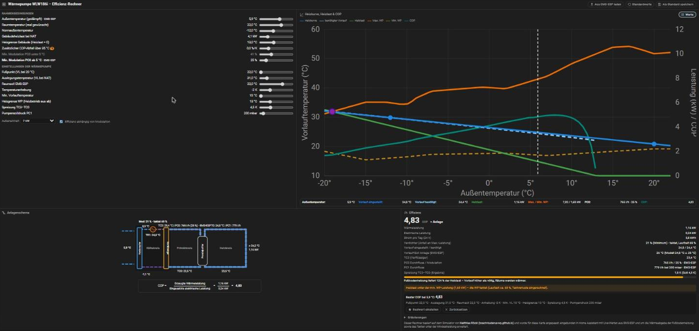
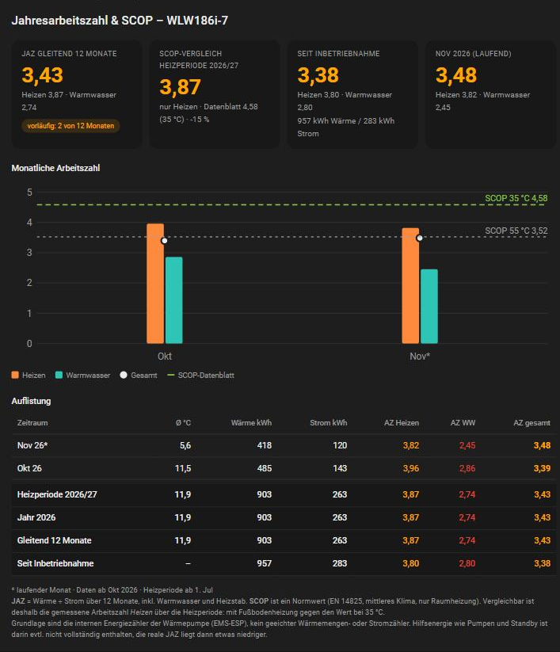

# WP Effizienz-Rechner & JAZ – Buderus WLW186i für Home Assistant

[](https://my.home-assistant.io/redirect/hacs_repository/?owner=WLW186iMuro&repository=wp-effizienz-card&category=plugin)

Zwei Dashboard-Karten für die Luft-Wasser-Wärmepumpe **Buderus Logatherm WLW186i** (Bosch-Schwestermodell: Compress 5800i/6800i AW), ausgelesen über [EMS-ESP](https://emsesp.org).

> Der Effizienz-Rechner basiert auf dem Simulator von **Matthias Röckl** ([bosch-buderus-wp.github.io](https://bosch-buderus-wp.github.io/)). Er wurde für Home Assistant angepasst und erweitert (Live-Werte aus EMS-ESP, Wärmeabgabe der Fußbodenheizung, Takten unter der Mindestleistung) und wird mit seiner Erlaubnis unter seiner MIT-Lizenz verwendet. Danke dafür.

| Karte | Typ | Zweck |
|---|---|---|
| Effizienz-Rechner | `custom:wp-simulator-card` | Heizkurve, Heizlast und COP durchrechnen. Regler verschieben und sofort sehen, wie sich Vorlauf, Spreizung, Pumpendruck, COP und Stromverbrauch pro Tag ändern. |
| JAZ & SCOP | `custom:wp-jaz-card` | Jahresarbeitszahl und Monatsarbeitszahlen aus der Langzeitstatistik, Vergleich mit dem SCOP laut Datenblatt. |





## Installation

1. Auf **Open in HACS** klicken. Alternativ: HACS → ⋮ → *Benutzerdefinierte Repositories* → diese Repository-URL, Kategorie **Dashboard**.
2. **Herunterladen**. HACS trägt die Ressource selbst ein und hält sie aktuell.
3. Browser-Cache leeren (Strg+F5), dann stehen beide Karten in der Kartenauswahl.

Dashboards im YAML-Modus: Ressource `/hacsfiles/wp-effizienz-card/wp-effizienz-card.js` als *JavaScript-Modul* von Hand eintragen.

## Dashboard anlegen

Fertige Konfiguration mit beiden Ansichten zum Einfügen: [`examples/dashboard.yaml`](examples/dashboard.yaml). Beide Ansichten als Typ **Panel**.

**Vor dem ersten Einsatz die Anlagenwerte setzen.** Die eingebauten Werte stammen von einer Beispielanlage (WLW186i-7 AR mit TP70 und Fußbodenheizung):

```yaml
type: custom:wp-simulator-card
defaults:
  nat: -10      # Normaußentemperatur des Standorts
  loadKw: 5.0   # Gebäudeheizlast bei NAT in kW (aus der Heizlastberechnung)
  limit: 15     # Heizgrenze
  ti: 21        # gewünschte Raumtemperatur
```

Die Einstellungen der Wärmepumpe (Fußpunkt, Auslegungstemperatur, Raumsoll, Spreizung, Pumpendruck usw.) holt die Schaltfläche **Aus EMS-ESP laden** direkt aus der Anlage. Ebenso übernimmt die Karte die gedämpfte Außentemperatur live.

## Voraussetzungen

- Home Assistant mit EMS-ESP (MQTT-Discovery) und den Standardnamen `sensor.boiler_…`, `sensor.thermostat_…`, `number.thermostat_…`
- Das Rechenmodell ist für die **7-kW-Außeneinheit (WLW-7 MB AR) mit Inneneinheit TP70 und Fußbodenheizung** hinterlegt. Andere Leistungsgrößen brauchen eigene Kennwerte in `WPS_PROFILES` in `dist/wp-simulator-card.js`.
- Die JAZ-Karte nutzt `recorder/statistics_during_period`. Die Energiezähler der Wärmepumpe müssen also in der Langzeitstatistik stehen (Standard bei EMS-ESP-Entitäten mit `state_class`).

Ein eigener Helfer ist nicht nötig. Den Primärkreis-Durchfluss rechnet die Karte mit der eingebauten Pumpenkennlinie selbst. Wer einen eigenen Sensor hat, gibt ihn unter `entities: { pc0flow: … }` an.

## Optionen

### Effizienz-Rechner

- `title`: Überschrift
- `defaults`: Startwerte der Regler (siehe oben)
- `entities`: abweichende Entitäten, auch im Karten-Editor einstellbar
- `controls`: Bereich und Schrittweite einzelner Regler, z. B. `loadKw: { min: 2, max: 20, step: 0.5 }`
- `shift`: Parallelverschiebung der Heizkurve (`room`, `offset`, `ref`), an der eigenen Anlage ermitteln
- `storage_key`: eigener Speicherplatz im Browser, wenn die Karte mehrfach verwendet wird

Reglerstellungen, Standardwerte und Bestwerte liegen nur im Browser (localStorage), nichts verlässt deinen Home Assistant.

### JAZ & SCOP

```yaml
type: custom:wp-jaz-card
scop35: 4.58          # SCOP laut Datenblatt bei 35 °C
scop55: 3.52          # SCOP laut Datenblatt bei 55 °C
season_start_month: 7 # Beginn der Heizperiode
```

Weitere Optionen: `heat_heating`, `heat_dhw`, `el_heating`, `el_dhw` (Listen möglich), `outdoor`, `months`, `min_kwh`.

## Hinweise

- Der Effizienz-Rechner ist ein Rechenmodell, kein Messgerät. Grundlage sind die Kennwerte der Buderus-Planungsunterlage WLW176i/186i AR (2024/04) und der Rechenkern des Simulators von **Matthias Röckl** ([bosch-buderus-wp.github.io](https://bosch-buderus-wp.github.io/), MIT-Lizenz, Verwendung vom Autor erlaubt). Details und Lizenztext in [NOTICE.md](NOTICE.md).
- Die JAZ-Karte nutzt die internen Energiezähler der Wärmepumpe, keinen geeichten Zähler. Die reale JAZ liegt etwas niedriger, weil Hilfsenergie darin evtl. fehlt.
- Privates Hobbyprojekt, keine Verbindung zu Bosch oder Buderus. Die Namen sind Marken der jeweiligen Inhaber. Nutzung auf eigene Verantwortung; die Karten verändern keine Einstellungen an der Heizung.

Lizenz: [MIT](LICENSE), Drittcode siehe [NOTICE.md](NOTICE.md)
